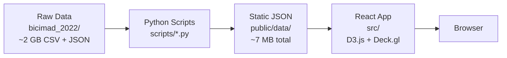

# BiciMAD 2022 — Interactive Bike-Share Visualization

An interactive web application exploring Madrid's BiciMAD public bike-share system through three research questions, using ~4.1 million trips and 8,738 hourly station snapshots from 2022.

## Research Questions

| # | Question | Idiom | Key Interaction |
|---|----------|-------|-----------------|
| Q1 | Which periodic patterns (daily, weekly, seasonal) shape demand? | Heatmap with switchable granularity | Toggle hour×weekday / day×month / calendar; filter by station |
| Q2 | How is usage distributed across the station network? | Map + linked histogram & Lorenz curve | Brush histogram to highlight stations on map |
| Q3 | What is the structure of the flow network? | OD matrix reordered by community detection | Click station to highlight row/column; threshold slider |

## Architecture



**Tech Stack:** React 19 + Vite · D3.js v7 · Deck.gl v9 · MapLibre GL · lucide-react · Vanilla CSS glassmorphism

## Quick Start

### Prerequisites
- Node.js ≥ 18
- Python ≥ 3.10

### 1. Install dependencies
```bash
npm install
```

### 2. Run preprocessing pipeline
```bash
# Create virtual environment and install Python deps
python3 -m venv .venv
.venv/bin/pip install -r scripts/requirements.txt

# Run all preprocessing scripts in order
.venv/bin/python scripts/preprocess.py      # stations.json + holidays.json
.venv/bin/python scripts/q1_temporal.py     # Q1 temporal aggregations
.venv/bin/python scripts/q2_spatial.py      # Q2 station usage
.venv/bin/python scripts/q3_flows.py        # Q3 OD matrix + Louvain
```

### 3. Start development server
```bash
npm run dev
```

Open http://localhost:5173 in your browser.

## Project Structure

```
├── bicimad_2022/           # Raw data (read-only, ~2 GB)
│   ├── trips_22_MM_*.csv   # Trip logs, 12 monthly files
│   └── 2022MM.json         # Station snapshots, 12 monthly files
├── scripts/                # Python preprocessing pipeline
│   ├── preprocess.py       # Station metadata + holidays
│   ├── q1_temporal.py      # Temporal aggregations
│   ├── q2_spatial.py       # Station usage counts
│   ├── q3_flows.py         # OD matrix + Louvain communities
│   └── requirements.txt
├── public/data/            # Pre-processed JSON (generated)
│   ├── stations.json       # 264 station records
│   ├── holidays.json       # Spain 2022 holidays
│   ├── q1_hour_weekday.json
│   ├── q1_day_month.json
│   ├── q1_calendar.json
│   ├── q2_station_usage.json
│   └── q3_od_matrix.json
├── src/                    # React application
│   ├── components/
│   │   ├── Layout.jsx      # Navigation shell
│   │   ├── Q1Temporal.jsx  # Temporal patterns page
│   │   ├── Q2Spatial.jsx   # Spatial distribution page
│   │   ├── Q3Flows.jsx     # Flow network page
│   │   ├── Heatmap.jsx     # Reusable D3 heatmap
│   │   ├── StationMap.jsx  # Deck.gl scatterplot map
│   │   ├── Histogram.jsx   # D3 histogram with brush
│   │   ├── LorenzCurve.jsx # D3 Lorenz curve
│   │   ├── ODMatrix.jsx    # Canvas OD matrix
│   │   └── ui/             # Glassmorphism primitives
│   ├── hooks/useData.js    # JSON fetch + cache
│   ├── utils/              # Colors, formatters
│   ├── App.jsx
│   └── index.css           # Design tokens
├── package.json
└── vite.config.js
```

## Data Caveats

| Issue | Detail |
|-------|--------|
| **Two CSV schemas** | Jan/Mar–Jul have 19 columns (with `idTrip`); Feb/Aug–Dec have 18. Always select by column name. |
| **Filler rows** | Every data row is followed by an empty semicolons-only row. Filtered out in preprocessing. |
| **Geolocation format** | Python literal `{'type': 'Point', 'coordinates': [lon, lat]}`. Parsed with `ast.literal_eval()`. |
| **August 18–22 gap** | Trip recording drops to ~300/day (normally ~9K). Excluded from all aggregations. Annotated in UI. |
| **Station join key** | CSV `station_unlock`/`station_lock` → JSON `stations[].id`. NOT the `number` field. |
| **Lat/lon strings** | JSON latitude/longitude are strings — cast to float. |

## Design Decisions

- **Glassmorphism UI**: Inspired by [EME Studios](https://emestudios.com) — semi-transparent cards with backdrop blur, warm off-white background (#F5F3EF), generous whitespace, uppercase tracking labels.
- **Louvain community detection**: Applied to symmetrized OD matrix via `python-louvain`. Found 3 communities (73, 105, 86 stations). Matrix rows/columns reordered by community then within-community degree.
- **Canvas OD matrix**: 264×264 = ~70K cells rendered on HTML Canvas for performance. SVG would be too slow.
- **Static data pipeline**: All aggregation done server-side in Python. Browser loads ~7 MB of pre-computed JSON — no backend needed.
- **Client-side station filtering**: Q1 includes stationId dimension in aggregated data (~6 MB). Filtered in-browser to avoid 792 separate files.

## Verified Dataset Figures

| Metric | Value |
|--------|-------|
| Total trips | 4,144,134 |
| Station snapshots | 8,738 |
| Stations | 264 |
| Distinct bikes | 4,263 |
| Network capacity | 6,315 docks |
| Median trip duration | 10.75 min |
| Busiest hour | 19:00 (325,745 trips) |
| Busiest day | 2022-05-11 (30,479 trips) |
| Louvain communities | 3 groups |
